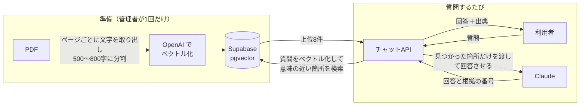

# 社内文書検索AI（RAG）

社内規程などの PDF に書かれている内容を、チャットで質問して調べられる Web アプリです。
回答には必ず「どの文書の何ページに書いてあるか」が付くので、AI の答えをその場で原文と照らし合わせられます。

> 模擬案件（学習用）として作ったものです。同梱のテストデータに出てくる会社「株式会社テックブリッジ」とその規程は架空です。

## できること

| 機能 | 内容 |
|---|---|
| 💬 文書への質問 | 「リモートワークのコアタイムは？」のように普段の言葉で質問すると、取り込んだ PDF の内容をもとに AI が答えます |
| 📄 出典の表示 | すべての回答に「ファイル名 p.ページ番号」の出典が付きます。出典は AI が書いた文字ではなく、実際に検索で見つかった箇所から付けるので、存在しない出典が表示されることはありません |
| 🚫 「該当なし」の判定 | 文書に書かれていないこと（例:「退職金はいくら？」）や、文書から推測しないと答えられないことには、無理に答えず「該当なし」と返します |
| 🔐 社内メール限定ログイン | 許可したドメインのメールアドレスだけがログインできます。パスワードは不要で、メールに届くリンクを押すだけでログインできます |
| 📊 精度の自動評価 | 質問と正解のセットを用意すると、正答率・出典付与率・「該当なし」の判定率を自動で採点します（管理者向け） |

## 使い方（利用者向け）

### 1. ログインする

1. アプリの URL を開くと、ログイン画面が表示されます。
2. 社内のメールアドレスを入力して「ログインリンクを送る」を押します。
3. 届いたメールのリンクを、**ログイン画面を開いたのと同じブラウザで**開きます。チャット画面に切り替われば完了です。

- メールが届かないときは、迷惑メールフォルダも確認してください。
- 短時間に何度も送信すると、しばらく送れなくなります。数分待ってから再度お試しください。
- 社外のメールアドレスではログインできません。

### 2. 質問する

画面下の入力欄に質問を書いて送信します（`Enter` で送信、`Shift + Enter` で改行）。

**回答できた場合** — 回答の下に出典が表示されます。

```
自己都合により退職する場合は、退職希望日の30日前までに退職届を提出します。

出典
  case3-doc1-employment-rules.pdf p.2
```

**文書に答えが無い場合** — 「該当なし」と表示されます。

```
該当なし：社内文書の中に、この質問に答えられる記載が見つかりませんでした。
```

### 上手に質問するコツ

- **1つの質問では1つのことを聞く** と答えが正確になります。
- 「該当なし」になったら、**文書で使われていそうな言葉に言い換えて** みてください（例:「在宅の手当」→「在宅勤務手当」）。
- 「私の場合は違法？」のように**判断を求める質問には答えません**。文書に書かれた事実だけを答える仕組みです。
- 回答は AI が作っています。大事な判断の前には、**出典のページを開いて原文を確認** してください。

### 3. ログアウトする

画面右上の「ログアウト」を押します。

## しくみ



1. **取り込み**: PDF をページ単位で読み、短い断片に分けて、文章の「意味」を表す数値（ベクトル）に変換して保存します。ページ番号は断片ごとに記録します。
2. **検索**: 質問も同じようにベクトルに変換し、意味が近い断片を探します。言い回しが違っても（「有給」と「年次有給休暇」など）見つけられます。
3. **回答**: 見つかった断片だけを Claude に渡し、「書かれていることだけで答える」「無ければ該当なしと言う」というルールで回答させます。
4. **出典**: Claude には根拠にした断片の番号だけを返させ、ファイル名とページ番号はデータベースの値から付けます。

## 技術構成

| 役割 | 使っているもの |
|---|---|
| 画面・API | Next.js 16（App Router / TypeScript） |
| ホスティング | Vercel（東京リージョン） |
| データベース・ベクトル検索 | Supabase（PostgreSQL + pgvector、東京リージョン） |
| ログイン | Supabase Auth（メールのマジックリンク） |
| 回答生成 | Claude API |
| ベクトル化 | OpenAI `text-embedding-3-small` |

## 自分で動かす（管理者・開発者向け）

### 必要なもの

- Node.js 20 以上
- Supabase のプロジェクト
- Anthropic と OpenAI の API キー

### 1. インストールと環境変数

```bash
npm install
cp .env.example .env.local   # 値を書き込む
```

| 変数 | 内容 |
|---|---|
| `NEXT_PUBLIC_SUPABASE_URL` | Supabase の Project URL（`https://xxxx.supabase.co`。末尾に `/rest/v1/` は付けない） |
| `NEXT_PUBLIC_SUPABASE_ANON_KEY` | Supabase の anon キー |
| `SUPABASE_SERVICE_ROLE_KEY` | Supabase の service_role キー。**PDF 取り込み・評価スクリプト専用**。Vercel やブラウザには絶対に設定しない |
| `ANTHROPIC_API_KEY` | Claude API のキー |
| `OPENAI_API_KEY` | OpenAI API のキー |
| `ALLOWED_EMAIL_DOMAIN` | ログインを許可するドメイン。`@` より後ろだけを書く（例: `example.co.jp`） |

### 2. Supabase の設定

1. `supabase/migrations/` の SQL を古い順に実行します（テーブル・検索関数・ログイン制限の作成）。
2. 許可するドメインを登録します（`ALLOWED_EMAIL_DOMAIN` と同じ値）。
   ```sql
   insert into public.allowed_email_domains (domain) values ('example.co.jp');
   ```
3. 管理画面の **Authentication → Hooks** で「Before User Created」を追加し、Postgres 関数 `public.hook_before_user_created` を選びます。
4. **Authentication → URL Configuration** で、Site URL にアプリの URL を、Redirect URLs に `<アプリのURL>/auth/callback` を登録します（ローカルなら `http://localhost:3000`）。

### 3. PDF を取り込む

```bash
# data/pdfs/ に PDF を置いてから
npm run ingest
```

- 同じファイル名の PDF をもう一度取り込むと、そのファイルの内容は丸ごと入れ替わります（重複しません）。
- 文字を選択できない PDF（スキャン画像）は読み取れず、失敗一覧に表示されます。
- 文書の断片は回答生成のときに外部の AI API へ送られます。取り込んでよい文書か事前に確認してください。

### 4. 起動する

```bash
npm run dev      # http://localhost:3000
```

### 5. 精度を評価する

```bash
npm run eval -- data/eval/case3.json
```

テストセットの書き方は [`data/eval/README.md`](data/eval/README.md) を参照してください。結果は `reports/eval/` に保存されます（社内文書の内容を含むため Git には入りません）。

| 指標 | 目標 |
|---|---|
| 正答率（文書に答えがある質問） | 80% 以上 |
| 出典付与率 | 100% |
| 「該当なし」の判定率（文書に答えが無い質問） | 100% |

### Vercel にデプロイする

1. このリポジトリを Vercel にインポートします（リージョンは `vercel.json` で東京 `hnd1` を指定済み）。
2. 環境変数に `NEXT_PUBLIC_SUPABASE_URL` / `NEXT_PUBLIC_SUPABASE_ANON_KEY` / `ANTHROPIC_API_KEY` / `OPENAI_API_KEY` / `ALLOWED_EMAIL_DOMAIN` を設定します（`SUPABASE_SERVICE_ROLE_KEY` は設定しない）。
3. Supabase の Redirect URLs に `<本番URL>/auth/callback` を追加します。

## フォルダ構成

```
src/
  app/
    page.tsx            チャット画面
    login/              ログイン画面
    auth/               ログインリンクの戻り先・ログアウト
    api/chat/route.ts   チャットAPI（認証確認 → 回答）
  components/           チャット画面の部品
  lib/chat/             RAG の本体（検索 → Claude で回答 → 出典照合）
  proxy.ts              未ログイン時にログイン画面へ移動させる
scripts/
  ingest/               PDF 取り込みスクリプト
  eval/                 精度評価スクリプト
supabase/migrations/    データベースの定義
data/eval/              評価用テストセット
```
